# Bot-Commands

Alle Befehle sind Discord-Slash-Commands. Die meisten Einrichtungspanels und
Ergebnisnachrichten sind nur für die aufrufende Person sichtbar. Commands mit
dem Hinweis **Moderation** erfordern standardmäßig eine der Rollen
**Offiziere** oder **Moderator**. Die Namen können in `configuration.json`
unter `moderator_roles` angepasst werden. Bot-Berechtigungen und
Kanalberechtigungen sind zusätzlich erforderlich.

Registrierungen und Spenden werden je Kanal eingerichtet. Prüfe vor
Änderungs-, Reset- und Entfernen-Befehlen, dass du dich im richtigen Kanal
befindest.

## Erforderliche Discord-Berechtigungen

Die folgenden Rechte werden der **Bot-Rolle** zugewiesen. Erteile nur die
Rechte, die zu den tatsächlich verwendeten Modulen und Befehlen passen, und
prüfe zusätzlich die kanalbezogenen Überschreibungen. Discord prüft Rechte im
Zielkanal. Deshalb können fehlende Kanalrechte trotz Serverberechtigung einen
Befehl verhindern.

| Bereich | Erforderliche Bot-Berechtigungen |
| --- | --- |
| Antworten und Übersichten | **View Channels**, **Send Messages**, **Embed Links** |
| Registrierungen (`/registration`) | **Manage Roles**, **Manage Channels**, **View Channels**, **Send Messages**, **Read Message History**, **Attach Files**, **Embed Links** |
| WZ-Verwaltung (`/wz`) | **Manage Roles**, **Manage Channels**, **View Channels**, **Send Messages**, **Read Message History**, **Attach Files**, **Embed Links** |
| Qs (`/qs`) | **View Channels**, **Send Messages**, **Embed Links**, **Read Message History**, **Create Public Threads**, **Send Messages in Threads**, **Manage Threads** |
| Spenden (`/donation`) | **View Channels**, **Send Messages**, **Read Message History**, **Embed Links** |
| Nachrichtenbereinigung (`/purge`, `/wz reset-channels`) | Zusätzlich **Manage Messages** |
| Rollen zurücksetzen (`/wz reset-roles`) | Zusätzlich **Manage Roles** |
| Registrierung als CSV exportieren (`/registration csv`) | **Attach Files** |
| Entfernen von Spenden (`/donation remove`) | Zusätzlich **Manage Messages** |
| Qs entfernen oder zurücksetzen (`/qs remove`, `/qs reset`) | Zusätzlich **Manage Messages** und **Manage Threads** |

Die Gruppen `/registration` und `/wz` prüfen das jeweilige gemeinsame Rechtebündel
für ihre Commands. Daher benötigen diese Gruppen auch Rechte, die nur einzelne
Funktionen wie Rollenänderungen, Kanalverwaltung oder Dateianhänge verwenden.
Für `/about-bot`, `/account` und `/set-timezone` ist kein eigenes
Bot-Berechtigungsbündel hinterlegt. Der Bot muss im jeweiligen Kontext
Interaktionsantworten senden können.

### Rechte der ausführenden Moderatoren

Einrichtung und Moderation erfordern standardmäßig eine Serverrolle, deren Name
in `configuration.json` unter `moderator_roles` aufgeführt ist (standardmäßig
**Offiziere** oder **Moderator**). Zusätzlich wird bei `/qs remove` und
`/qs reset` die Discord-Berechtigung **Manage Messages** von der aufrufenden
Person geprüft. Bei allen anderen in dieser Anleitung als moderationsgeschützt
gekennzeichneten Commands genügt laut Command-Check die konfigurierte Rolle.
die Bot-Berechtigungen gelten unabhängig davon.

Für Rollenverwaltung muss die Bot-Rolle in der Server-Rollenhierarchie oberhalb
der Rollen stehen, die der Bot zuweisen oder entfernen soll. Eine Rolle kann
keine gleichrangigen oder höher stehenden Rollen verwalten.

## Allgemeine Commands

### `/about-bot`

Zeigt Informationen und einen Projektlink an.

| Parameter | Typ | Standard | Beschreibung |
| --- | --- | --- | --- |
| `ephemeral` | Ja/Nein | `true` | Wenn aktiviert, ist die Antwort nur für dich sichtbar. |

### `/purge`

Löscht passende Nachrichten im aktuellen Textkanal oder Thread. Der Bot benötigt
**Manage Messages**. Eine Moderatorrolle ist erforderlich.

| Parameter | Typ | Standard | Beschreibung |
| --- | --- | --- | --- |
| `limit` | Zahl | `500` | Maximale Anzahl aktueller Nachrichten, die geprüft werden. |
| `ignore_bots` | Ja/Nein | `true` | Überspringt Nachrichten von Bots. |
| `ignore_pinned` | Ja/Nein | `true` | Überspringt angepinnte Nachrichten. |
| `ephemeral` | Ja/Nein | `true` | Zeigt die Ergebnisnachricht nur dir. |

### `/set-timezone`

Setzt die gemeinsame IANA-Zeitzone des Servers. Die Zeitzone wird für lokale
Datums- und Uhrzeiteingaben der Module verwendet. Die Auswahl bietet
Autocomplete, zum Beispiel `Europe/Berlin`. Moderatorrolle erforderlich.

| Parameter | Typ | Beschreibung |
| --- | --- | --- |
| `timezone` | Text | IANA-Zeitzonenkennung, beispielsweise `Europe/Berlin`. |

## Spielkonten

Spielkonten sind pro Server eindeutig einem Discord-Mitglied zugeordnet. Die
Konten werden für Registrierungsbefehle verwendet.

### `/account account-add`

Verknüpft einen Ingame-Account mit deinem Discord-Mitglied. Ein Account darf
serverweit nur einmal verknüpft werden. Die Eingabe muss zwischen 1 und 100
Zeichen lang sein.

| Parameter | Typ | Beschreibung |
| --- | --- | --- |
| `account` | Text | Name des Ingame-Accounts. |

### `/account account-remove`

Hebt die Verknüpfung des gewählten eigenen Accounts auf. Zu diesem Account
gehörende Registrierungen und nicht anderweitig benötigte Rollen werden ebenfalls
entfernt. Der Parameter bietet Autocomplete mit deinen verknüpften Accounts.

| Parameter | Typ | Beschreibung |
| --- | --- | --- |
| `account` | Text | Einer deiner verknüpften Ingame-Accounts. |

### `/account account-list`

Zeigt deine verknüpften Ingame-Accounts und deinen Discord-Anzeigenamen an.
Keine Parameter.

## Registrierungen

Alle `/registration`-Befehle gelten für den aktuellen Kanal. Moderatorrolle
erforderlich, ausgenommen `/registration register` und
`/registration deregister`, die Mitglieder selbst verwenden. Der Bot benötigt
für die Gruppe insbesondere **Manage Roles**, **Manage Channels**, **View
Channels**, **Send Messages**, **Read Message History**, **Attach Files** und
**Embed Links**.

### `/registration setup`

Öffnet ein privates Einrichtungspanel ohne Slash-Parameter. Dort konfigurierst
du:

- Titel und Beschreibung der Übersicht,
- Registrierungsrollen sowie deren permanenten oder nicht permanenten Status,
- die Anzeige von Sperr-Emojis,
- optional einen Exportkanal.

Änderungen werden über das Panel gespeichert. Registrierungen können je Server
in mehreren Kanälen eingerichtet werden. Eine Rolle kann nur einer Registrierung
zugeordnet sein.

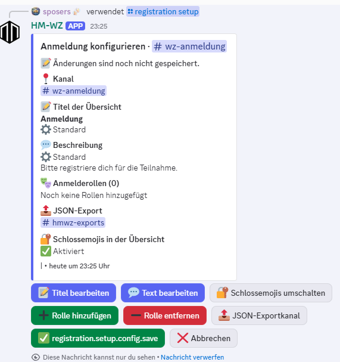

### `/registration remove`

Öffnet eine Bestätigung, um die Einrichtung des aktuellen Kanals sowie die
zugehörigen Nachrichten und Daten zu entfernen. Keine Slash-Parameter.

### `/registration register`

Meldet im aktuellen Kanal einen eigenen Account für eine konfigurierte Rolle an.
Account und Rolle bieten Autocomplete. Der Account muss mit
`/account account-add` verknüpft sein. Alternativ kann der eigene Discord-
Anzeigename verwendet werden.

| Parameter | Typ | Beschreibung |
| --- | --- | --- |
| `account` | Text | Einer deiner verknüpften Accounts oder der Eintrag für deinen Anzeigenamen. |
| `role` | Text | Eine in diesem Kanal konfigurierte Registrierungsrolle. |

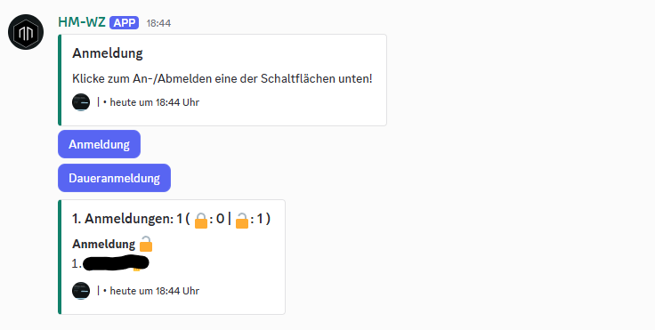

### `/registration deregister`

Meldet einen eigenen Account im aktuellen Kanal ab. Der Vorschlag für `account`
ist auf Accounts beschränkt, die dort registriert sind.

| Parameter | Typ | Beschreibung |
| --- | --- | --- |
| `account` | Text | Der eigene registrierte Account oder die Anzeigenamen-Registrierung. |

### `/registration reset`

Setzt im aktuellen Kanal die nicht permanenten Registrierungen zurück.
Moderatorrolle erforderlich.

| Parameter | Typ | Standard | Beschreibung |
| --- | --- | --- | --- |
| `ephemeral` | Ja/Nein | `false` | Zeigt das Ergebnis nur der aufrufenden Person. |
| `purge` | Ja/Nein | `false` | Bereinigt zusätzlich Registrierungsnachrichten. |

### `/registration snapshot`

Exportiert die Registrierungen des aktuellen Kanals als JSON in den
konfigurierten Exportkanal, ohne sie zurückzusetzen. Es gibt keine Parameter.
Moderatorrolle erforderlich.

### `/registration csv`

Sendet einen CSV-Export der Registrierungen des aktuellen Kanals. Der Bot
benötigt **Attach Files**. Moderatorrolle erforderlich.

| Parameter | Typ | Standard | Beschreibung |
| --- | --- | --- | --- |
| `ephemeral` | Ja/Nein | `true` | Macht die Antwort mit dem CSV-Anhang nur für dich sichtbar. |

## WZ-Verwaltung

Das `/wz`-Modul verwaltet seine Rollen und Bereinigungskanäle unabhängig von den
Registrierungseinstellungen. Alle Befehle erfordern die Moderatorrolle.

### `/wz setup`

Öffnet ein privates Panel, in dem WZ-Rollen und zusätzliche
Bereinigungskanäle hinzugefügt oder entfernt werden. Keine Parameter.

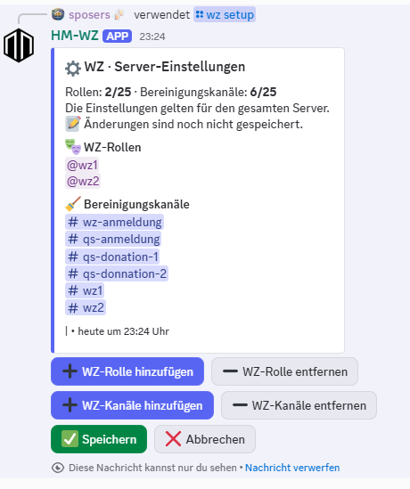

### `/wz reset-channels`

Zeigt die konfigurierten Bereinigungskanäle zur Bestätigung an. Im Dialog können
Ausnahmen gewählt werden. Angepinnte Nachrichten werden standardmäßig
geschont. Erfordert **Manage Messages**. Keine Parameter.

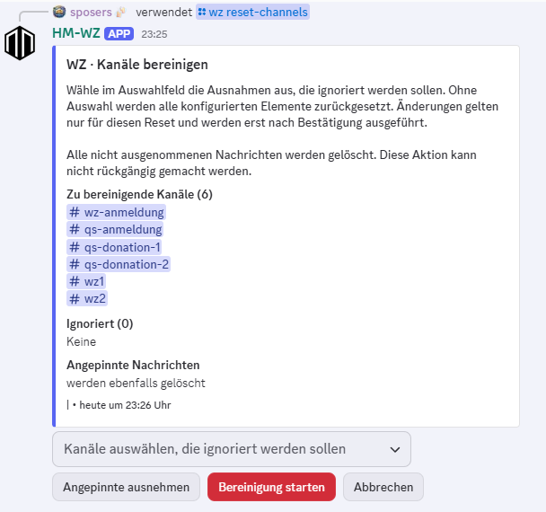

### `/wz reset-roles`

Zeigt die konfigurierten WZ-Rollen zur Bestätigung an. Im Dialog können Rollen
als Ausnahmen festgelegt werden. Erfordert **Manage Roles**. Keine Parameter.

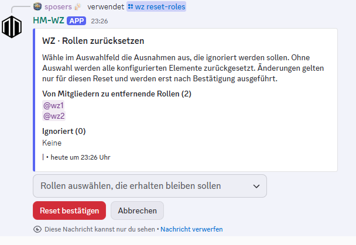

## Qs-Planung

Qs-Einrichtung und Qs-Daten sind kanalbezogen und unabhängig von Registrierungen
und WZ-Rollen. Die Moderatorrolle ist für die aufgeführten `/qs`-Commands
erforderlich. Der Bot benötigt **View Channel**, **Send Messages**, **Embed
Links**, **Read Message History**, **Create Public Threads**, **Send Messages in
Threads** und **Manage Threads**.

### `/qs setup`

Öffnet ein privates Setup ohne Slash-Parameter. Das Panel konfiguriert:

- die Qs-Rolle für den Kanal,
- den Startzeitpunkt der 24-stündigen Eruption,
- vier oder fünf Phasen mit Startstunde (0–23) und Dauer (1–3 Stunden),
- Benachrichtigungen für Eruptionsstart/-ende, Phasenziel und Teilnehmer beim
  Phasenstart.

Datums- und Uhrzeiteingaben verwenden die Server-Zeitzone aus
`/set-timezone`. Das Setup bearbeitet den bestehenden Termin. Es löscht keine
Anmeldungen oder Basenmeldungen.

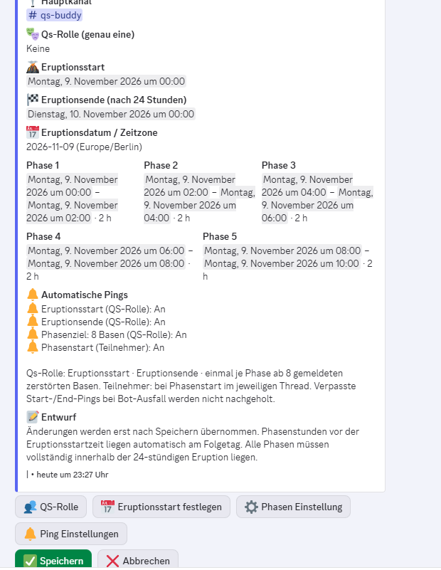

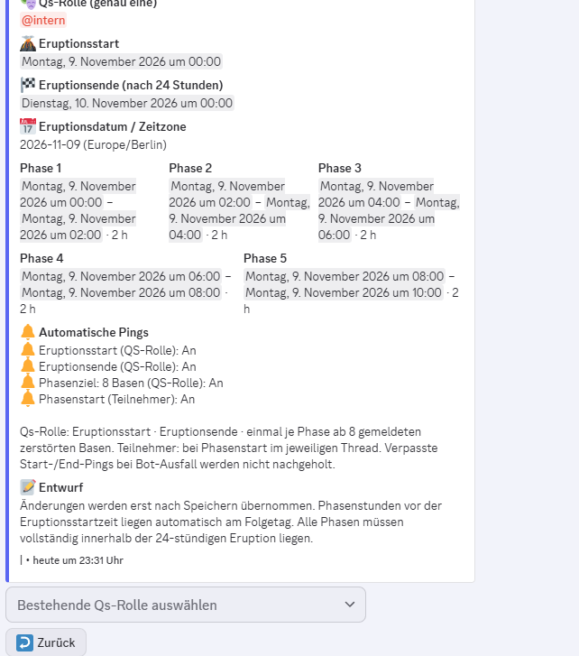

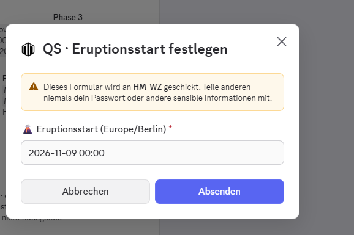

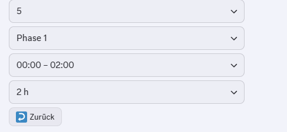

### `/qs remove`

Zeigt nach Bestätigung die Entfernung des Qs-Tools für den aktuellen Kanal an.
Entfernt Qs-Übersichten, Phasenthreads und Qs-Daten, aber nicht den Hauptkanal,
die ausgewählte Rolle oder fremde Nachrichten. Eine Moderatorrolle ist
erforderlich. Außerdem benötigen sowohl Moderator als auch Bot
**Manage Messages**. Der Bot braucht zusätzlich **Manage Threads**. Keine
Parameter.

### `/qs reset`

Öffnet das Setup für einen neuen Eruptionszeitplan. Die abschließende Bestätigung
löscht alle Nachrichten im Hauptkanal und in den zugehörigen Qs-Threads,
einschließlich angepinnter und fremder Nachrichten. Anmeldungen, Basenmeldungen
und Ping-Markierungen werden zurückgesetzt. Rolle und Ping-Einstellungen
bleiben erhalten. Erfordert **Manage Messages** bei Moderator und Bot sowie
**Manage Threads** beim Bot. Keine Parameter.

### `/qs ping`

Benachrichtigt gezielt die konfigurierte Qs-Rolle im aktuellen Kanal. Höchstens
ein Aufruf pro Minute und Kanal. Keine Parameter.

### `/qs report`

Öffnet eine Bestätigung, um für ein Mitglied eine Basenmeldung hinzuzufügen.
Die Phase muss im aktuellen Kanal eingerichtet sein. Moderatorrolle
erforderlich.

| Parameter | Typ | Beschreibung |
| --- | --- | --- |
| `player` | Mitglied | Discord-Mitglied, für das die Meldung erfolgt. |
| `phase` | ganze Zahl, 1–5 | Nummer der konfigurierten Phase. |

### `/qs withdraw`

Öffnet eine Bestätigung, um die Basenmeldung eines Mitglieds im aktuellen Kanal
zurückzunehmen. Moderatorrolle erforderlich.

| Parameter | Typ | Beschreibung |
| --- | --- | --- |
| `player` | Mitglied | Discord-Mitglied, dessen Meldung zurückgenommen wird. |

Mitglieder melden sich für Phasen über die Übersicht an oder ab und melden
zerstörte Basen im jeweiligen Phasenthread. Eine Basenmeldung erfordert keine
Phasenanmeldung. Pro Spieler ist eine Meldung je Eruption möglich.

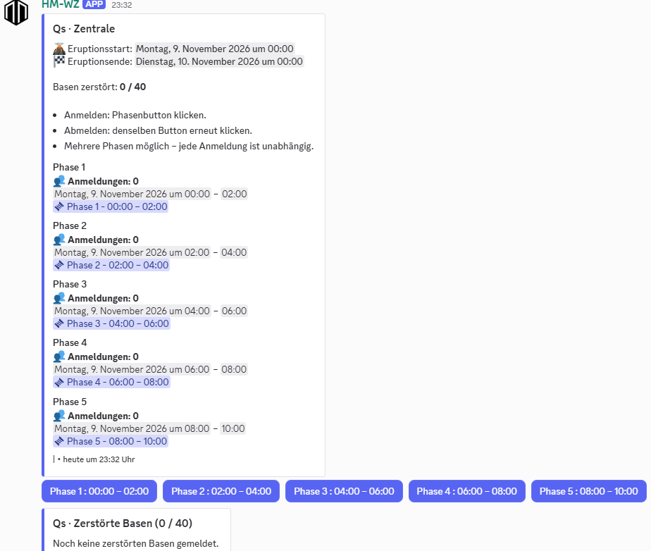

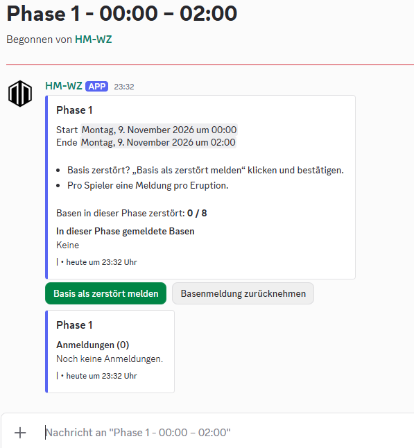

## Spenden

Alle `/donation`-Befehle arbeiten mit der Einrichtung im aktuellen Kanal und
erfordern eine Moderatorrolle.

### `/donation setup`

Öffnet ein privates Setup ohne Slash-Parameter. Bei einer neuen Einrichtung
wählst du zwischen einfachen Credit-/Ressourcenspenden und Rush-Spenden. Im
Setup lassen sich Titel, Beschreibung, Darstellung, Betragsauswahl und optional
ein JSON-Exportkanal festlegen. Jede Spende muss vor dem Speichern bestätigt
werden.

Rush-Spenden bieten **1 h**, **8 h** und **24 h**. Ihre Preise berücksichtigen
die bereits im Zyklus gespendete Beschleunigung. Ein optionales Ziel begrenzt
die angebotenen Optionen entsprechend Ziel und verbleibender Zeit.

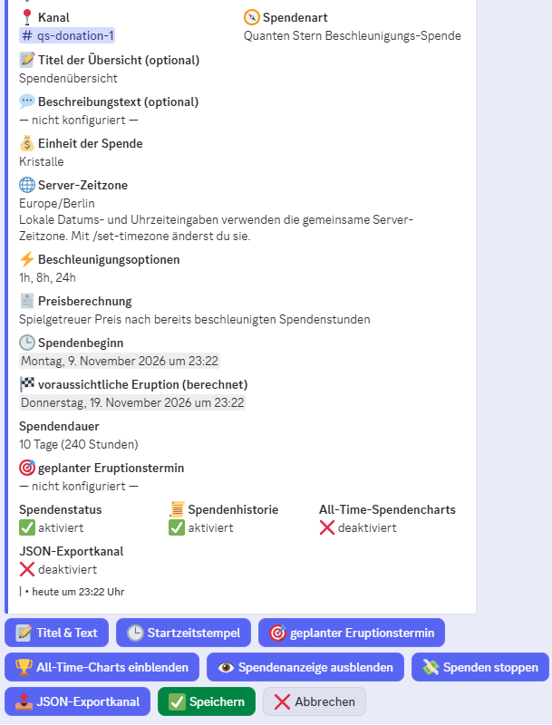

### `/donation remove`

Öffnet eine Bestätigung, um die Einrichtung, Nachrichten und Spenden des
aktuellen Kanals zu entfernen. Erfordert **Manage Messages** beim Bot. Keine
Parameter.

### `/donation reset`

Startet nach Bestätigung einen neuen Spendenzyklus. Bei Rush-Spenden führt der
Dialog auch die benötigten Datums- und Zeiteingaben. Dabei gilt die mit
`/set-timezone` gesetzte Zeitzone. Ist ein Exportkanal konfiguriert, wird vor
dem Zykluswechsel ein Export erstellt. Schlägt dieser fehl, wird der Reset
abgebrochen. Keine Parameter.

### `/donation snapshot`

Exportiert den aktuellen Spendenzyklus als JSON in den eingerichteten
Exportkanal, ohne den Zyklus zurückzusetzen. Keine Parameter.