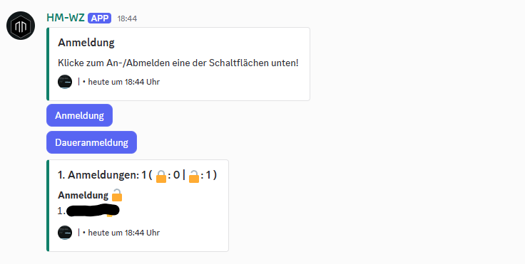

# HmWz

**HmWz** ist ein modularer Discord-Bot für die Verwaltung von WZ-Anmeldungen
und Spendenübersichten für das Spiel **Hadestar**. Er stellt interaktive
Übersichten bereit, vergibt Discord-Rollen und speichert Einstellungen sowie
Anmeldungen serverbezogen in einer SQLite-Datenbank.



## Funktionsumfang

Die aktuell eingebundenen Funktionen umfassen:

- **Registrierungen:** Pro Server lassen sich mehrere Anmeldungen in
  unterschiedlichen Kanälen einrichten. Mitglieder melden sich über
  Schaltflächen an oder ab; Rollen können als permanent oder nicht permanent
  konfiguriert werden.
- **Ingame-Accounts:** Mitglieder können Accounts mit ihrem Discord-Konto
  verknüpfen und ihre Anmeldungen über `/account` und `/registration` verwalten.
- **WZ-Verwaltung:** Eine separate WZ-Einrichtung verwaltet eigene Rollen und
  Kanäle. Bestätigte Resets können Rollen entfernen oder Nachrichten in
  ausgewählten Kanälen bereinigen.
- **Spendenübersichten:** Pro Kanal kann ein System für einfache Spenden oder
  Rush-Spenden mit interaktiver Eingabe, Bestätigung und Spendenhistorie
  eingerichtet werden. Für Rush-Spenden gelten die festen Optionen 1, 8 und
  24 Stunden; die Preise berücksichtigen die bereits gespendete Beschleunigung.
- **Exporte:** Registrierungsdaten und Spendenzyklen können als JSON exportiert
  werden, sofern ein Exportkanal eingerichtet ist.
- **Moderationswerkzeuge:** `/purge` bereinigt Nachrichten im aktuellen
  Textkanal oder Thread; `/about-bot` zeigt Bot-Informationen.
- **Sprachen und Emojis:** Discord-Befehle unterstützen deutsche und englische
  Lokalisierungen. Application-Emojis ergänzen die Spendenübersichten.
- **Ressourcenprotokollierung:** Das optionale Monitoring protokolliert
  Schwellwertüberschreitungen für CPU, Arbeitsspeicher, Datenträger und – falls
  vom Betriebssystem bereitgestellt – Temperatur.

## Voraussetzungen

- Python **3.12 oder neuer**
- Eine Discord-Application mit Bot und ein Discord-Server, auf dem du den Bot
  installieren darfst
- Für die automatischen Installationsskripte: PowerShell unter Windows oder
  Bash unter Linux

## Discord-Bot vorbereiten

1. Erstelle im [Discord Developer Portal](https://discord.com/developers/applications)
   eine Application und darin einen Bot. Behandle den Bot-Token wie ein Passwort.
2. Aktiviere unter **Bot → Privileged Gateway Intents** den **Server Members
   Intent** und den **Message Content Intent**. Der Bot aktiviert außerdem den
   `guilds`-Intent.
3. Erstelle unter **OAuth2 → URL Generator** eine Einladungs-URL mit den Scopes
   `bot` und `applications.commands`.
4. Gewähre dem Bot die für die verwendeten Funktionen nötigen Rechte. Dazu
   gehören typischerweise **View Channels**, **Send Messages**, **Embed Links**,
   **Read Message History**, **Manage Roles**, **Manage Messages**, **Manage
   Channels** und **Attach Files**. Die nötigen Rechte unterscheiden sich je
   nach verwendetem Command; für Rollenänderungen braucht der Bot insbesondere
   **Manage Roles**.
5. Setze die Bot-Rolle in der Server-Rollenliste oberhalb der Rollen, die der Bot
   vergeben oder entfernen soll. Discord erlaubt keine Verwaltung gleichrangiger
   oder höherer Rollen. Kanalberechtigungen können die Serverrechte zusätzlich
   einschränken.
6. Starte den Bot. Er synchronisiert die Slash-Commands global; neue Commands
   können einige Zeit brauchen, bis sie in Discord erscheinen.

Moderator- und Einrichtungskommandos prüfen die Serverrollen **Offiziere** oder
**Moderator**. Für solche Commands muss die ausführende Person eine dieser Rollen
besitzen. Die jeweiligen Bot-Berechtigungen sind zusätzlich erforderlich.

## Installation und Start

Führe die folgenden Befehle im Projektverzeichnis aus. Konfiguration, Datenbank
und Logdatei werden relativ zum aktuellen Arbeitsverzeichnis gespeichert.

### Automatische Installation

Die Skripte richten die virtuelle Umgebung und Abhängigkeiten ein, fragen
optional den Bot-Token ab und können den automatischen Start konfigurieren.

**Windows (PowerShell):**

```powershell
.\scripts\win\install.ps1
```

**Linux:**

```bash
bash scripts/linux/install.bash
```

Die Schritte können auch einzeln ausgeführt werden:

| Schritt | Windows (PowerShell) | Linux (Bash) |
| --- | --- | --- |
| Virtuelle Umgebung | `.\scripts\win\create_venv.ps1` | `bash scripts/linux/create_venv.bash` |
| Abhängigkeiten | `.\scripts\win\install_dependencies.ps1` | `bash scripts/linux/install_dependencies.bash` |
| Token speichern | `.\scripts\win\configure_token.ps1` | `bash scripts/linux/configure_token.bash` |
| Automatischen Start einrichten | `.\scripts\win\install_service.ps1` | `bash scripts/linux/install_service.bash` |

Unter Windows registriert das Skript eine Aufgabenplaner-Aufgabe im Kontext des
aktuellen Benutzers. Sie startet bei dessen Anmeldung. Unter Linux wird ein
systemd-Dienst eingerichtet und gestartet; dafür werden `systemd` und `sudo`
benötigt. Führe das Installationsskript als Bot-Benutzer und nicht als `root`
aus. Die Skripte zum Starten und Stoppen liegen in `scripts/win/` beziehungsweise
`scripts/linux/`.

**Hinweis:** Prüfe Skripte, bevor du sie ausführst. Lokal gespeicherte Tokens
sind vertraulich zu behandeln. Wenn ein Token veröffentlicht wurde, erneuere
ihn im Developer Portal.

### Manuelle Installation

**Windows (PowerShell):**

```powershell
py -3.12 -m venv venv
.\venv\Scripts\python.exe -m pip install -r requirements.txt
$env:WZ_BOT_TOKEN = "DEIN_DISCORD_BOT_TOKEN"
.\venv\Scripts\python.exe src\bot.py
```

**Linux:**

```bash
python3 -m venv venv
./venv/bin/python -m pip install -r requirements.txt
export WZ_BOT_TOKEN="DEIN_DISCORD_BOT_TOKEN"
./venv/bin/python src/bot.py
```

Alternativ kann das Paket installiert und mit `hmwz` gestartet werden:

```bash
python -m pip install .
hmwz
```

Der Token wird zuerst aus der Umgebungsvariable `WZ_BOT_TOKEN` gelesen. Als
Alternative unterstützen die Installationsskripte die Windows-Registry des
aktuellen Benutzers und unter Linux die Datei
`~/.config/hsbot/config`. Setze Umgebungsvariablen für einen dauerhaft laufenden
Dienst in dessen eigener Umgebung.

## Slash-Commands

Alle Befehle werden in Discord als Slash-Commands angeboten. Ein Teil der
Antworten und Einrichtungsdialoge ist nur für die aufrufende Person sichtbar.
Eine ausführliche Anleitung zur Konfiguration von Anmeldungen und Spenden für
Moderatoren steht in der [Moderator-Anleitung](moderator-anleitung.txt).

### Allgemeine Befehle

| Befehl | Zweck |
| --- | --- |
| `/about-bot` | Zeigt Informationen zum Bot an. Die Antwort ist standardmäßig privat. |
| `/purge` | Bereinigt Nachrichten im aktuellen Textkanal oder Thread. `limit` steht standardmäßig auf 500; Bots und angepinnte Nachrichten werden standardmäßig übersprungen. Die Filter sind einstellbar. Erfordert die Rolle **Offiziere** oder **Moderator**. |

### Ingame-Accounts

| Befehl | Zweck |
| --- | --- |
| `/account account-add` | Verknüpft einen Ingame-Account mit dem eigenen Discord-Mitglied. Ein Account kann pro Server nur einem Mitglied zugeordnet sein. |
| `/account account-remove` | Hebt die Verknüpfung auf und entfernt die zugehörigen Anmeldungen sowie nicht mehr benötigte Rollen dieses Accounts. |
| `/account account-list` | Zeigt die eigenen verknüpften Accounts an. |

### Registrierungen

Registrierungen werden je Kanal eingerichtet. Richten Moderatoren im jeweiligen
Kanal zuerst `/registration setup` ein, können Mitglieder dort über die
Übersichtsschaltflächen teilnehmen. Die verfügbaren Befehle sind:

| Befehl | Zweck |
| --- | --- |
| `/registration setup` | Öffnet das interaktive Setup für Titel, Beschreibung, Rollen und optionalen Exportkanal. |
| `/registration remove` | Entfernt nach Bestätigung die Einrichtung im aktuellen Kanal und die zugehörigen Daten und Nachrichten. |
| `/registration register` | Meldet einen eigenen Account oder den eigenen Anzeigenamen im aktuellen Kanal für eine konfigurierte Rolle an. |
| `/registration deregister` | Meldet den ausgewählten eigenen Account im aktuellen Kanal ab. |
| `/registration reset` | Setzt die nicht permanenten Anmeldungen im aktuellen Kanal zurück. Optional können die zugehörigen Nachrichten bereinigt werden. |
| `/registration snapshot` | Exportiert die Registrierungen des aktuellen Kanals in den konfigurierten JSON-Exportkanal, ohne sie zurückzusetzen. |

Die Konfiguration kann mehrere Anmeldungen pro Server verwalten. Eine Rolle
kann innerhalb der Registrierungen nur einer Anmeldung zugeordnet werden.
Registrierungsbefehle wirken im aktuellen Kanal; prüfe daher den Kanal vor
Reset- oder Entfernen-Aktionen sorgfältig.

Unveränderte Übersichten und Mitgliederlisten werden nicht erneut an Discord
gesendet; der automatisch erzeugte Zeitstempel zählt nicht als Inhaltsänderung.
Gleichzeitige Aktualisierungen werden je Anmeldungskanal zusammengefasst.
Änderungen während einer laufenden Synchronisierung werden in einem gemeinsamen
Nachlauf berücksichtigt. Nicht erzwungene Aktualisierungen innerhalb des
Mindestintervalls werden verzögert ausgeführt, statt verworfen zu werden.

### WZ-Verwaltung

Die WZ-Verwaltung führt ihre Kanäle und Rollen unabhängig von den
Registrierungseinstellungen. Das Setup und die Resets sind für **Offiziere** oder
**Moderator** vorgesehen.

| Befehl | Zweck |
| --- | --- |
| `/wz setup` | Öffnet das private Setup zum Hinzufügen und Entfernen von WZ-Rollen und Bereinigungskanälen. |
| `/wz reset-channels` | Bereinigt nach Bestätigung die konfigurierten WZ-Kanäle. |
| `/wz reset-roles` | Entfernt nach Bestätigung die konfigurierten WZ-Rollen von Mitgliedern. |

Beim Kanal-Reset können Ausnahmen ausgewählt werden; angepinnte Nachrichten
werden standardmäßig geschont. Beim Rollen-Reset können ebenfalls Ausnahmen
festgelegt werden. Ausnahmen ändern nicht die gespeicherte Konfiguration.

### Spenden

Mit `/donation setup` richtest du im aktuellen Textkanal eine einfache
Credit-/Ressourcenspende oder eine Rush-Spende ein. Titel, Beschreibung,
Anzeigeoptionen, optionale Betragsauswahl und ein JSON-Exportkanal können im
interaktiven Menü angepasst werden. Jede Spende muss bestätigt werden, bevor sie
gespeichert wird.

Rush-Spenden verwenden die Optionen **1h**, **8h** und **24h**. Der Preis hängt
von der bereits im aktuellen Zyklus gespendeten Beschleunigung ab. Ein
optionales Ziel kann eingerichtet werden; verfügbare Schaltflächen richten sich
danach, ob eine Spende das Ziel oder die verbleibende Zeit überschreiten würde.
Die Datums- und Zeiteingabe akzeptiert regionale Zeitzonen und berücksichtigt
Sommerzeit.

| Befehl | Zweck |
| --- | --- |
| `/donation setup` | Richtet die Spendenübersicht im aktuellen Kanal ein oder aktualisiert sie. |
| `/donation remove` | Entfernt nach Bestätigung die Einrichtung, ihre Nachrichten und die Spenden des aktuellen Kanals. |
| `/donation reset` | Startet im aktuellen Kanal einen neuen Spendenzyklus. |
| `/donation snapshot` | Exportiert den aktuellen Zyklus in den eingerichteten JSON-Exportkanal, ohne ihn zurückzusetzen. |

Eine Einrichtung kann in mehreren Kanälen separat angelegt werden. Das
optionale Ranking zählt kanalbezogen über mehrere Zyklen; die Historie zeigt
den aktuellen Zyklus. Einheiten lassen sich nach vorhandenen Spenden nicht
mehr ändern. Ist ein Exportkanal konfiguriert, erstellt ein Reset vor dem
Zykluswechsel einen Export. Schlägt dieser Export fehl, wird der Reset
abgebrochen.

## Konfiguration, Daten und Logs

Die Laufzeitkonfiguration liegt in [`configuration.json`](configuration.json)
im Projektstamm. Wenn die Datei fehlt, versucht die Anwendung beim Start eine
Datei mit Standardwerten zu erzeugen.

| Bereich | Einstellung | Bedeutung |
| --- | --- | --- |
| `database` | `folder`, `filename` | Ordner und Dateiname der SQLite-Datenbank. Standardmäßig `data/data.db`. |
| `monitoring` | `interval_seconds` | Abstand zwischen Ressourcenmessungen in Sekunden. |
| `monitoring` | `cpu_threshold`, `memory_threshold`, `disk_threshold`, `temperature_threshold` | Schwellwerte, ab denen das Monitoring Warnungen protokolliert. |
| `wz_registration` oder `hs.wz` | `min_registration_roles`, `max_registration_roles`, `default_title`, `default_description` | Standardwerte der WZ-Registrierung. `hs.wz` hat Vorrang; `wz_registration` wird für vorhandene Konfigurationen weiter unterstützt. |

Ändere die Konfiguration möglichst bei gestopptem Bot. Sichere vor Updates
oder Änderungen sowohl die Konfigurationsdatei als auch die Datenbank.

- **SQLite:** Die Datenbank enthält Servereinstellungen, Rollen- und
  Kanalzuordnungen, Anmeldungen und Spenden. Sie muss bei Neustarts erhalten
  bleiben.
- **Logs:** Der Einstiegspunkt schreibt `bot.log` im Projektverzeichnis.
- **Monitoring:** `psutil` aktiviert die periodischen Ressourcenmessungen. Das
  Paket ist in `requirements.txt` enthalten; ohne es kann der Bot weiterhin
  starten, das Monitoring ist dann deaktiviert.
- **Datenschutz:** Datenbank und Logs können Discord-IDs und Nutzungsdaten
  enthalten. Schütze Zugriffsrechte, Backups und Speicherorte entsprechend und
  veröffentliche diese Dateien nicht.

## Projektstruktur

```text
assets/                         Beispielbilder und Vorlagen
scripts/
  linux/                        Linux-Installation und systemd-Steuerung
  win/                          Windows-Installation und Aufgabenplaner
src/
  bot.py                        Einstiegspunkt
  hmwz/
    client/                     Discord-Client, Commands und Monitoring
    emojis/                     Application-Emojis und Unicode-Fallbacks
    i18n/                       Übersetzungen und Command-Lokalisierungen
    modules/
      donation/                 Spendenübersichten, Historie und Exporte
      registration/             Registrierungen, Rollen und Exporte
      hs/
        account/                Account-Kommandos und Account-Datenzugriff
        wz/                     Unabhängige WZ-Kanal- und Rollenverwaltung
    ui/                         Gemeinsame Discord-Dialoge und Komponenten
    configuration.py            Laufzeitkonfiguration
    sqlite_db.py                SQLite-Zugriff
    token_storage.py             Token-Auflösung
tests/                          Unit- und Integrationstests
configuration.json              Laufzeitkonfiguration
requirements.txt                Laufzeitabhängigkeiten
pyproject.toml                  Paket-, Hatch-, Lint- und Testkonfiguration
```

## Entwicklung und Tests

Für lokale Entwicklung installiere Python-Abhängigkeiten und Hatch. Das Projekt
definiert in `pyproject.toml` die Entwicklungswerkzeuge und Testkommandos:

```bash
python -m pip install -e ".[dev,monitoring]"
hatch run test
```

Für die vollständigen Prüfungen (Linting, Formatkontrolle, Typprüfung und Tests):

```bash
hatch run check
```

Einzelne Prüfungen lassen sich mit `hatch run lint`, `hatch run format-check`
und `hatch run typecheck` starten. `hatch run format` formatiert den Quellcode
und die Tests.

## Lizenz

Dieses Projekt steht unter der MIT-Lizenz. Siehe [`LICENSE`](LICENSE).
